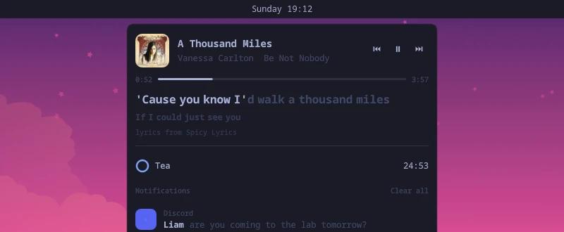

# banditshell island

The island from [banditshell](https://github.com/marcusbandit/banditshell), as a plugin for the Omarchy shell. It is listed on the [Omarchy plugin marketplace](https://plugins.omarchy.org/plugin.html?id=banditshell.island).


Nothing sits on screen at rest. When a notification arrives, the track changes or a timer rings, a pill melts out of the bottom of your bar, says it, and goes back up. Anything else going on waits beside it as a bud that pinched off the pill. Hover the pill, or the middle of the bar's bottom edge, and the island opens: what is playing with the line being sung, your timers, and your notifications.

## What it shows

- **Notifications.** Press one to run its action. A right press dismisses it. Critical ones stay until you deal with them. The island only takes over notifications when you switch off Omarchy's own, see below.
- **Now playing.** A glance when the track changes, unless the player's window is already in front of you.
- **Word-timed lyrics.** If you use [Spicy Lyrics](https://github.com/Spikerko/spicy-lyrics) in Spotify, the island reads its cache and lights each word as it is sung. Otherwise it gets line-timed lyrics from [lrclib.net](https://lrclib.net).
- **Timers.** `omarchy-shell banditshell-island timer 10m tea` starts one. A running timer sits in a small pill, and a finished one chimes and stays until you press it.
- **Sing along.** `omarchy-shell banditshell-island sing` keeps the current line on screen while music plays.

 

## Install

```sh
omarchy plugin add https://github.com/marcusbandit/banditshell-island.git --enable
```

### Let it show your notifications

Only one program can be the notification daemon, and on Omarchy that is the built-in one. The island never switches it off for you. To hand it over:

```sh
omarchy plugin disable omarchy.notifications
omarchy restart shell
```

Do not disturb keeps working, because the island answers the same `notifications` commands as Omarchy's daemon. To go back, run `omarchy plugin enable omarchy.notifications` and restart the shell.

## Keybinds

Add these to `~/.config/hypr/bindings.lua`, or pick your own keys:

```lua
o.bind("SUPER + ALT + I", "Island", { panel = "banditshell.island" })
o.bind("SUPER + ALT + L", "Sing along", { ipc = "banditshell-island.sing" })
```

## Commands

Every command is `omarchy-shell banditshell-island <command>`.

| Command | What it does |
| --- | --- |
| `toggle` | Open or close the island |
| `show`, `hide` | Open it, close it |
| `timer 25m tea` | Start a timer. Use `h`, `m` and `s`, and a bare number means minutes. Anything after the time is its name. |
| `cancelTimers` | Stop every timer |
| `sing` | Keep the current lyric line on screen while music plays, or stop |
| `state` | Print what the island is doing, as JSON |

## Settings

Settings go on the island's entry in `~/.config/omarchy/shell.json`. All of them are optional.

```json
{ "id": "banditshell.island", "glanceSeconds": 4, "width": 440 }
```

| Key | Default | Meaning |
| --- | --- | --- |
| `glanceSeconds` | `4` | How long a glance stays before the pill goes back up |
| `width` | `440` | Width of the open island, in pixels |
| `nowPlaying` | `true` | Glance when the track changes |
| `lyrics` | `true` | Look up lyrics for what is playing |
| `notifications` | `true` | Be the notification daemon once Omarchy's own is off |
| `history` | `20` | How many notifications the island keeps |
| `shown` | `4` | How many of them the open island lists |
| `monitor` | `"focused"` | Which screen the island is on: `"focused"` or a monitor name such as `"DP-1"` |

## Remove

```sh
omarchy plugin remove banditshell.island
omarchy plugin enable omarchy.notifications
omarchy restart shell
```

## Needs

- Omarchy 4 (Quattro) and its shell.
- `python3`, to read the Spicy Lyrics cache. Omarchy ships it.
- `pw-play` from PipeWire, for the timer chime.
- A network connection for lrclib.net lyrics. Nothing else leaves your machine. Spicy Lyrics is read from Spotify's cache on disk.

## Credits

The island, its shape and its motion come from [banditshell](https://github.com/marcusbandit/banditshell), a Hyprland shell written from scratch in [Quickshell](https://quickshell.org). The shape is one signed-distance field in a fragment shader: the pill, its buds and the neck that joins it to the bar are drawn together, which is why they melt into each other.

Lyrics come from the Spicy Lyrics cache in Spotify and from [lrclib.net](https://lrclib.net).

## License

GPL-3.0. See [LICENSE](LICENSE).
